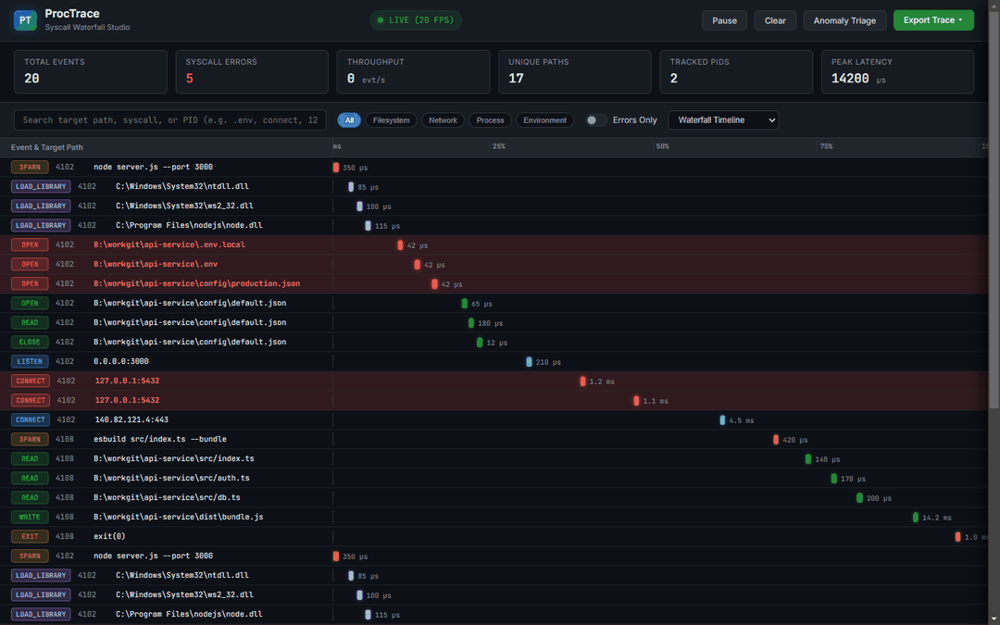
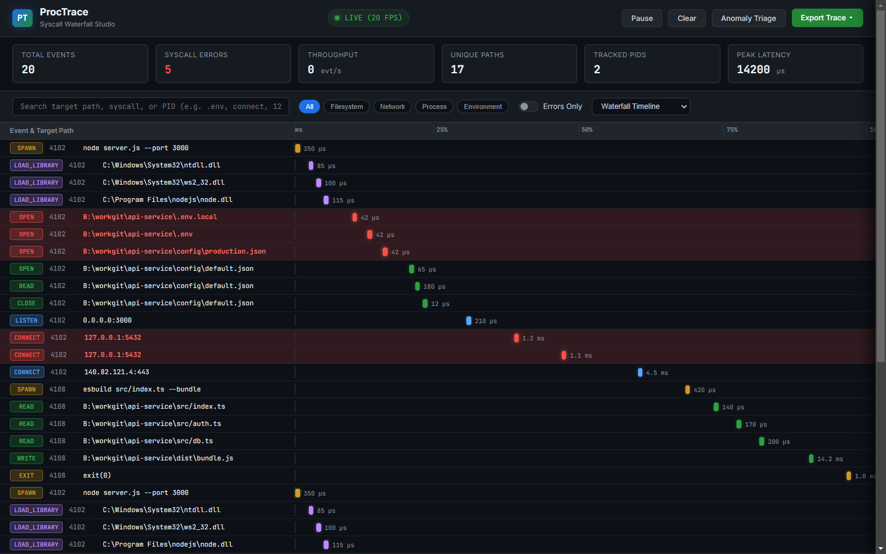
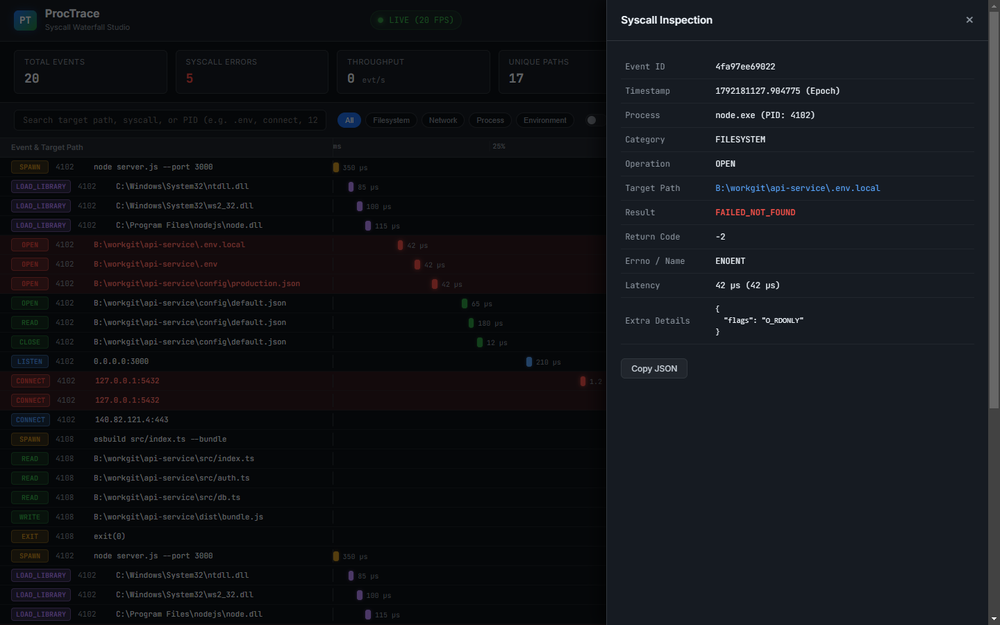
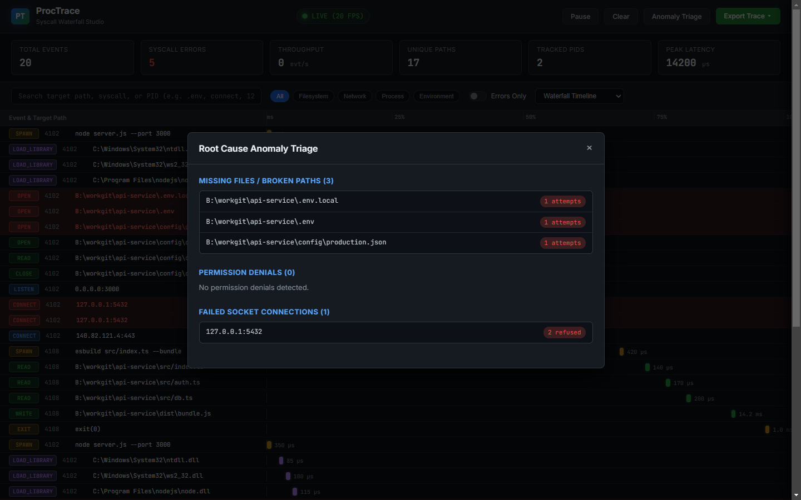
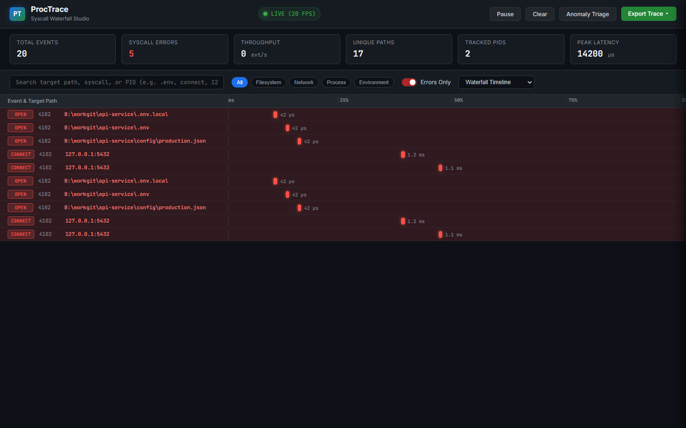

<p align="center">
  
</p>

<h1 align="center">ProcTrace</h1>

<p align="center">
  <strong>Cross-Platform Process Activity & Syscall Waterfall Monitor</strong>
</p>

<p align="center">
  A modern alternative to Sysinternals Process Monitor and strace. Delivers real-time observation of filesystem calls, socket connections, process trees, and permission errors with an interactive TUI and Chrome DevTools waterfall timeline.
</p>

<p align="center">
  <a href="LICENSE"></a>
  <a href="https://python.org"></a>
  <a href="https://fastapi.tiangolo.com"></a>
  <a href="https://textual.textualize.io"></a>
</p>


---

## Demo



---

## Why ProcTrace

When an application fails with generic errors like `Configuration file not found` or hangs during startup, diagnosing root causes is slow:
- Sysinternals Process Monitor is Windows-only, has an outdated interface, and outputs gigabytes of unformatted events.
- Linux strace outputs dense terminal streams that degrade throughput and freeze terminals.

ProcTrace delivers low-overhead system call observation across Windows, Linux, and macOS:
- Captures kernel and user-space events: filesystem operations, socket connections, process forks, and loaded dynamic libraries.
- Pre-allocated circular ring buffer holding 500,000 events with throughput exceeding 1.3 million events per second.
- Automatic error isolation: highlights failed lookups (`ENOENT`), permission denials (`EACCES`), and refused sockets (`ECONNREFUSED`).
- Chrome DevTools style waterfall timeline in both Web and Terminal interfaces.
- Exports to JSON, CSV, Markdown incident reports, and Chrome Trace Event Format for Perfetto.

---

## Visual Interfaces

### Web Studio Waterfall
The interactive Web Studio renders microsecond-accurate timeline swimlanes with category color-coding and live WebSocket streaming at 20 frames per second.



### Syscall Inspection Drawer
Clicking any waterfall bar opens the slide-over inspection drawer showing exact parameters, return codes, and latency.



### Root Cause Anomaly Triage
Aggregates broken file lookups, permission denials, and connection failures into actionable diagnostics.



### Error Isolation Mode
Isolates non-zero return codes, broken file descriptors, and refused network sockets into a dedicated high-priority timeline:




---

## Architecture

```
+-------------------------------------------------------------------+
|                        Target Process                             |
|               (CLI child run or attached PID)                     |
+---------------------------------+---------------------------------+
                                  |
+---------------------------------v---------------------------------+
|                    OS Kernel Event Collectors                     |
|  * Windows: ReadDirectoryChangesW, IP Helper (netstat), psutil    |
|  * Linux: ptrace syscall registers, procfs (/proc/<pid>/fd)       |
|  * macOS: dtrace, dtruss probes, Endpoint Security API            |
+---------------------------------+---------------------------------+
                                  | SyscallEvent stream
+---------------------------------v---------------------------------+
|                     Lock-Free Ring Buffer                         |
|  * 500,000 pre-allocated slots (zero memory leakage)              |
|  * Thread-safe atomic pointer logic (>1.3M events/sec)            |
|  * Microsecond timestamp indexing                                 |
+---------------------------------+---------------------------------+
                                  |
        +-------------------------+-------------------------+
        |                                                   |
+-------v-------------------------+       +-----------------v-------+
|   Filter & Anomaly Correlator   |       |     Export Pipeline     |
| * System noise suppression      |       | * Structured JSON       |
| * Missing file isolation (ENOENT)       | * Standard CSV          |
| * Refused sockets (ECONNREFUSED)|       | * Perfetto Chrome Trace |
+---------------+-----------------+       | * Markdown Summary      |
                |                         +-------------------------+
        +-------+-------+
        |               |
+-------v-------+ +-----v---------+
|  Textual TUI  | |  Web Studio   |
| * ASCII bars  | | * DevTools UI |
| * Sparkline   | | * WebSockets  |
+---------------+ +---------------+
```

---

## Installation

```bash
# Clone repository
git clone https://github.com/alexandrmotologa/proctrace.git
cd proctrace

# Install in editable mode
pip install -e .
```

Verify the installation and kernel collector capabilities:
```bash
proctrace doctor
```

Output:
```text
                     ProcTrace System Diagnostic (Doctor)                      
+-----------------------------------------------------------------------------+
| Component          | Status     | Details                                   |
|--------------------+------------+-------------------------------------------|
| Python Runtime     | OK         | Python 3.12.2 (CPython)                   |
| Operating System   | OK         | Windows 11 (AMD64)                        |
| Windows Collector  | Supported  | Win32 API, ReadDirectoryChangesW, psutil  |
| Process Privileges | OK         | Standard User (Kernel hooks active)       |
| Ring Buffer Speed  | High Speed | 1,375,084 events/sec                      |
+-----------------------------------------------------------------------------+
```

---

## Usage

### 1. Run and Trace Command
Launch a command under monitoring with the interactive Terminal UI:
```bash
proctrace run -- python app.py
```

Run headlessly and export to Chrome Trace format for Perfetto:
```bash
proctrace run --no-tui --output-chrome trace.json -- npm test
```

### 2. Attach to Running Process
Attach monitoring to an active background process:
```bash
proctrace attach 4120
```

### 3. Launch Web Studio
Start the DevTools waterfall web dashboard:
```bash
proctrace web --port 8995
```

Open a previously recorded trace file in the Web Studio:
```bash
proctrace web --load-trace trace.json
```

### 4. Export Recorded Traces
Convert saved JSON traces into other formats:
```bash
# Export to CSV
proctrace export trace.json --format csv --output trace.csv

# Export to Perfetto Chrome Trace format
proctrace export trace.json --format chrome --output trace_perfetto.json

# Export to Markdown Incident Report
proctrace export trace.json --format report --output incident_report.md
```

### 5. Regression Diffing
Compare two recorded trace runs to detect latency regressions, newly broken file lookups, or unexpected endpoint changes:
```bash
# Compare baseline run against current run
proctrace diff baseline.json current.json

# Save comparison as Markdown report
proctrace diff baseline.json current.json --output diff_report.md
```

### 6. Root-Cause Explanation & Remediation
Automatically translate failed syscalls into clear root-cause explanations and concrete shell commands:
```bash
proctrace explain trace.json
```
Diagnoses:
- Missing `.env` files (detects `.env.example` templates and suggests copy commands).
- Uninstalled dynamic libraries (`libssl`, `vcruntime140.dll`) with platform package manager commands.
- Stopped services on standard database and cache ports (PostgreSQL 5432, MySQL 3306, Redis 6379, MongoDB 27017).
- Permission denied (`EACCES`) paths with file ownership and `chmod` recommendations.

### 7. Security & Credential Audit
Detect credential exposure and data exfiltration patterns:
```bash
proctrace audit trace.json
```
Audits:
- Access to sensitive credentials (`~/.ssh/id_rsa`, AWS tokens, Docker configs, kubeconfig, shadow/SAM files).
- Exfiltration chains: flags outbound network connections opened within 5 seconds of reading sensitive credential files.

### 8. CI/CD Operational Assertions
Enforce performance and operational policies in continuous integration pipelines. Exits with status code 1 on violation:
```bash
# Fail build if any config lookup fails or if any syscall takes longer than 50ms
proctrace assert --no-missing-configs --max-latency-ms 50 -- pytest

# Block unencrypted HTTP network calls in production builds
proctrace assert --no-unencrypted-http -- npm run build
```


---

## Filter Presets

ProcTrace includes ready-to-use YAML filter presets in `configs/filters/`:

- `configs/filters/missing-files.yaml`: Focuses exclusively on missing configuration files and broken paths (`ENOENT`).
- `configs/filters/network-only.yaml`: Isolates socket connections, listens, accepts, and DNS queries.
- `configs/filters/slow-io.yaml`: Captures system calls exceeding 10ms of latency.
- `configs/filters/full-audit.yaml`: Captures all activity across filesystem, network, and process lifecycle.

```bash
proctrace run --filter-config configs/filters/missing-files.yaml -- python server.py
```

---

## Documentation

- [Architecture Overview](docs/architecture.md)
- [CLI Reference Guide](docs/cli-reference.md)
- [OS Collector Internals](docs/os-collector-internals.md)
- [Waterfall Timeline Guide](docs/waterfall-guide.md)

---

## License

MIT License. See [LICENSE](LICENSE) for details.
